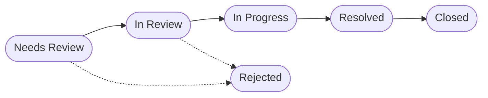
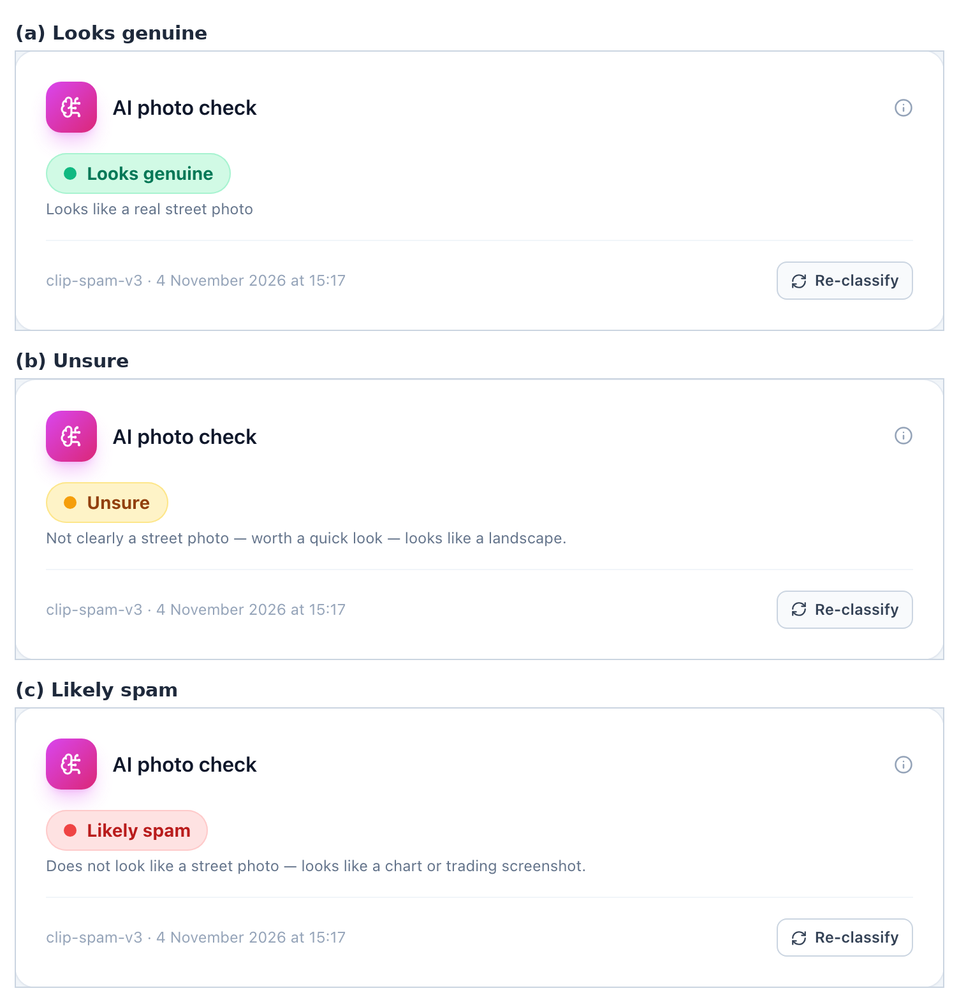
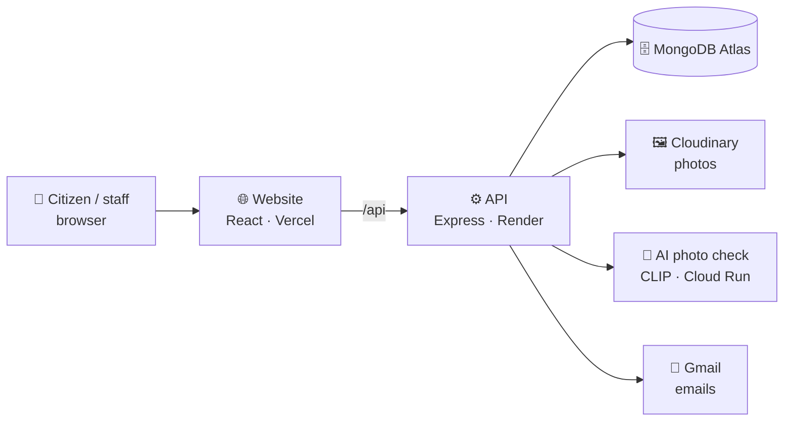

<div align="center">

# 🛣️ MeroSadak

**मेरो सडक · "my street"**

Report a problem on your street in Nepal, then follow it until it's fixed.

[](https://merosadak-an.vercel.app/)
[](https://a-web-based-system-for-reporting-and.onrender.com/api/health)


</div>

MeroSadak is my final-year project for BSc (Hons) Computer Science. It is a
website where people in Nepal can report problems on their street, like a
pothole or a broken streetlight, and then check what is happening with their
report. Staff at the ward office get their own dashboard where they look at the
reports and update them.

The full project title is *A Web-Based System for Reporting and Tracking
Street-Level Infrastructure Issues in Nepali Communes*.

> [!NOTE]
> This is a student prototype. It works, but it is not a real government
> service, so please don't use it to report real problems.

> [!TIP]
> The API runs on Render's free plan and goes to sleep when nobody is using
> it. If the live website is slow the first time, wait up to a minute and
> refresh.

## Contents

- [Quick start (for markers)](#-quick-start-for-markers)
- [What it does](#-what-it-does)
- [The AI photo check](#-the-ai-photo-check)
- [How it fits together](#-how-it-fits-together)
- [Run it from GitHub](#-run-it-from-github)
- [Running the tests](#-running-the-tests)
- [Putting it online](#-putting-it-online)
- [Things I learned](#-things-i-learned)
- [Privacy notes](#-privacy-notes)

---

## 🚀 Quick start (for markers)

The easiest way to see the project is the
**[live website](https://merosadak-an.vercel.app/)**. Nothing needs installing.

To run it on your own computer from the submitted zip:

1. Install [Node.js](https://nodejs.org/) version 20.19 or newer (the "LTS"
   download is fine). Check it with `node -v`.
2. Unzip the folder. The settings file `server/.env` is already included, so
   you don't need to set anything up. It connects to my online database and
   photo storage.
3. Open a terminal in the unzipped folder and start the API:

   ```bash
   cd server
   npm install
   npm run dev
   ```

   Leave it running. It should say it is listening on port 5050 and connected
   to MongoDB.

4. Open a **second** terminal in the same folder and start the website:

   ```bash
   cd client
   npm install
   npm run dev
   ```

5. Go to **<http://localhost:5173>** in your browser.

The commands are the same on Windows, macOS and Linux. The first
`npm install` takes a few minutes.

| | |
| --- | --- |
| 👮 **Staff dashboard** | <http://localhost:5173/officer/login>. Use the staff login details I gave with my submission. |
| 🤖 **AI photo check** | Optional. Without it, the API uses a made-up AI result so the dashboard still works. To run the real one, see [step 3](#3-start-everything) (needs Python 3.11). |
| 📧 **Emails** | Not sent from the zip copy. Reset codes and report updates are printed in the API terminal instead. |

<details>
<summary><b>If something goes wrong</b></summary>

| Problem | Fix |
| --- | --- |
| `npm` or `node` not found | Install Node.js (step 1), then open a new terminal |
| Website loads but shows no reports / errors | Make sure the API terminal (step 3) is still running |
| `EADDRINUSE` / port already in use | Close whatever is using port 5050 or 5173, or restart the computer |
| API says it can't connect to MongoDB | Check your internet connection. Some university networks block MongoDB's port 27017, so try another network |

</details>

---

## ✨ What it does

<table>
<tr>
<td width="50%" valign="top">

### 🧑‍🤝‍🧑 For citizens
*No account needed*

- 📸 Report a problem with a photo. Pick one of six types: pothole, damaged
  road sign, broken streetlight, faded road markings, damaged footpath, or
  blocked roadside drain.
- 📍 Say where it is. Press **"Use my location"** or type a description like
  *"Ward 6, near Shree Ganesh Temple"*.
- 🔢 Get a reference number (something like **#42**) and use it to track
  your report.
- 🗂️ Browse reports that other people have made on the public reports page.

</td>
<td width="50%" valign="top">

### 🏛️ For ward staff
*Login needed*

- 📥 See a queue of new reports and move each one through the steps below.
- 🗺️ See the place on a map if the citizen shared their location.
- 🙈 Black out faces and number plates in a photo before it goes public.
- 📊 Look at simple analytics, manage staff accounts, and add notes.

</td>
</tr>
</table>

**The life of a report:**



---

## 🤖 The AI photo check

When someone submits a photo, a small AI model called
[CLIP](https://openai.com/research/clip) looks at it and guesses whether it is
a real street photo or spam (for example a picture of a chair, a selfie, or a
screenshot of a trading chart). Staff see one of three labels:

| 🟢 Looks genuine | 🟡 Unsure | 🔴 Likely spam |
| :---: | :---: | :---: |
| Looks like a real street photo | Worth a quick look | Probably not a street photo |

It is only a hint. **A person always makes the final decision**, and citizens
never see the label.

<p align="center">
  
</p>

**How well it works** (test set of 114 photos the model had never seen):

| Result | Score |
| --- | --- |
| Correct when it gave a clear answer | **113 / 113 (100%)** |
| Real street photos wrongly marked as spam | **0 / 54** |
| Spam wrongly marked as genuine | **0 / 60** |
| Said "Unsure" | 1 / 114 |

The full evaluation, charts and how to re-run it are in
[evaluation/README.md](evaluation/README.md).

---

## 🧩 How it fits together



| Part | Tech | Folder |
| --- | --- | --- |
| Website (frontend) | React, Vite, Tailwind CSS, React Router | [`client/`](client/) |
| API (backend) | Node.js, Express, Mongoose | [`server/`](server/) |
| Database | MongoDB Atlas (in the cloud) | n/a |
| Photo storage | Cloudinary | n/a |
| AI photo check | Python, FastAPI, CLIP (`openai/clip-vit-base-patch32`) | [`classifier/`](classifier/) |
| Maps | Leaflet with OpenStreetMap | n/a |

```
.
├── client/        the React website (citizen pages + staff dashboard)
├── server/        the Express API, database models and tests
├── classifier/    the Python service that runs the CLIP photo check
├── deploy/        Cloud Run build settings for the classifier
└── evaluation/    my thesis evaluation: app test reports + the AI photo check test
```

---

## 💻 Run it from GitHub

These steps are for running it from a GitHub clone. If you have the submitted
zip, use the [Quick start](#-quick-start-for-markers) above instead.

```bash
git clone https://github.com/laxmantrades/-A-Web-Based-System-for-Reporting-and-Tracking-Street-Level-Infrastructure-Issues-in-Nepali-Communes.git MeroSadak
cd MeroSadak
```

### 1. Things you need first

- [Node.js](https://nodejs.org/) 20.19+ (or 22.12+)
- A free [MongoDB Atlas](https://www.mongodb.com/atlas) database
- A free [Cloudinary](https://cloudinary.com/) account (this is where photos
  are saved)

### 2. Make the settings file (`.env`)

The API reads its passwords and keys from a file called `server/.env`. This
file is **not** in the GitHub repo (it is git-ignored) because it holds real
secrets, so after cloning you have to make it yourself.

Create `server/.env` and fill in your own values:

```bash
# Required
PORT=5050
MONGODB_URI=mongodb+srv://<user>:<password>@<cluster>/merosadak
CLOUDINARY_URL=cloudinary://<api_key>:<api_secret>@<cloud_name>
CLIENT_ORIGIN=http://localhost:5173

# Optional: the AI photo check (see step 3). Leave out to use a made-up result.
CLASSIFIER_URL=http://localhost:8000/classify
```

<details>
<summary><b>Optional: sending real emails</b></summary>

Without these, emails are just printed in the API terminal.

```bash
# Option A: Gmail SMTP with an App Password
SMTP_HOST=smtp.gmail.com
SMTP_PORT=465
SMTP_USER=you@gmail.com
SMTP_PASS=your-app-password
MAIL_FROM="MeroSadak <you@gmail.com>"

# Option B: Gmail API (used on Render, where SMTP is blocked).
# Get the refresh token with: node scripts/gmailRefreshToken.js
GMAIL_CLIENT_ID=...
GMAIL_CLIENT_SECRET=...
GMAIL_REFRESH_TOKEN=...
```

</details>

A few rules for the file:

- One setting per line, written as `NAME=value`, with no spaces around `=`.
- Put quotes around a value only if it has spaces in it, like `MAIL_FROM`.
- Never commit `.env` or paste it into an issue or chat. Before you push,
  `git status` should not list it.
- If you change `.env`, restart the API (`npm run dev`) so it picks up the
  new values.

The website (`client/`) does not need a `.env`. In development it sends
`/api` requests to `http://localhost:5050`. If your API runs somewhere else,
start it with `API_TARGET=<url> npm run dev`.

### 3. Start everything

Open two terminals:

```bash
# terminal 1: the API
cd server
npm install
npm run dev

# terminal 2: the website
cd client
npm install
npm run dev
```

Without the AI service running, the API uses a made-up AI result while you're
developing, so the dashboard still has something to show. To run the real one
you need Python 3.11. In a third terminal:

```bash
cd classifier
python3.11 -m venv .venv
.venv/bin/pip install torch==2.5.1 --index-url https://download.pytorch.org/whl/cpu
.venv/bin/pip install -r requirements.txt
.venv/bin/uvicorn app:app --port 8000
```

Then add `CLASSIFIER_URL=http://localhost:8000/classify` to `server/.env` and
restart the API. The first start is slow because it downloads the CLIP model
(about 600 MB). After that it is cached.

### 4. Open it

| What | Where |
| --- | --- |
| Website | <http://localhost:5173> |
| Staff login | <http://localhost:5173/officer/login> |
| API health check | <http://localhost:5050/api/health> |
| AI service health check (if it's running) | <http://localhost:8000/health> |

### 5. Staff accounts

The database already has two staff accounts:

| Email | Role |
| --- | --- |
| `officer@ward.gov.np` | Ward officer |
| `admin@ward.gov.np` | Admin |

Their passwords are not in this repo. Markers get them with my submission.

If you want some example reports to play with as well:

```bash
cd server
node scripts/seedTrackingDemo.js
```

---

## 🧪 Running the tests

The backend has automated tests written with Jest. They use a temporary
in-memory database, so they don't touch your real data.

```bash
cd server
npm install
npm test
```

You can also test the AI photo check live: send it one photo, or re-run the
whole thesis evaluation against the running classifier. The steps are in
[evaluation/README.md](evaluation/README.md#running-the-tests-yourself).

---

## ☁️ Putting it online

| Part | Where it runs | Cost |
| --- | --- | --- |
| Website | [Vercel](https://merosadak-an.vercel.app/) | Free |
| API | [Render](https://a-web-based-system-for-reporting-and.onrender.com/api/health) | Free |
| AI photo check | Google Cloud Run | Free tier (needs a billing card) |

Step-by-step guide: **[DEPLOY.md](DEPLOY.md)**.

---


## 🔒 Privacy notes

- Citizens don't need an account. Their email is only used to send updates.
- Faces and number plates can be blacked out by staff before a photo is shown
  publicly.
- The raw AI score is saved for my evaluation, but it is never shown on any
  page or returned by the API.

---

<div align="center">

*Made by Laxman Giri as a final-year project.*

</div>
